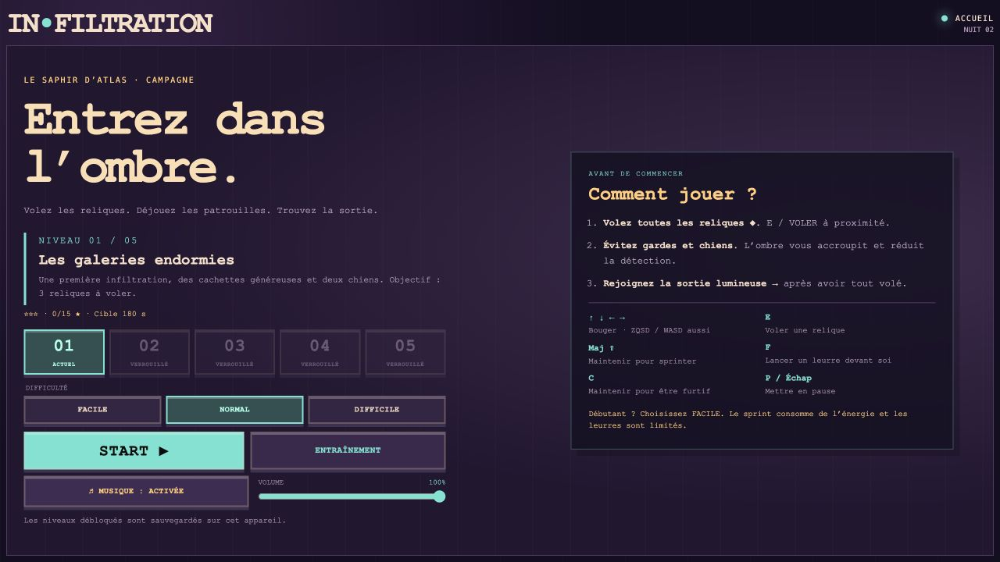

# IN•FILTRATION — Le Saphir d’Atlas

Jeu de furtivité en JavaScript et p5.js : infiltrez un musée de nuit, récupérez toutes les reliques, puis rejoignez la sortie. Projet pédagogique sur les comportements de déplacement et la neuro-évolution.

## Jouer en ligne sur ordinateur

[▶ Ouvrir le jeu complet](https://camelchafii691.github.io/infiltration-musee/)

Aucun téléchargement ni compte requis : ouvrez le lien, lisez les consignes et cliquez sur **START**. Les commandes au clavier sont indiquées dans le menu et ci-dessous.



## Jouer en local

Prérequis : **Node.js 22 ou plus récent**. Aucun paquet à installer, aucun compte requis.

```bash
npm start
```

Ouvrez [le jeu local](http://127.0.0.1:8080). Les consignes sont affichées sur l’accueil. Les fichiers du jeu et p5.js sont inclus ; aucun CDN n’est nécessaire.

## Le jeu

- Cinq cartes distinctes, avec **3, 4, 5, 6 puis 7 reliques**.
- Trois difficultés : Facile, Normal, Difficile.
- Gardes en patrouille, chef et suiveurs, chiens en meute et voleurs rivaux.
- Accroupissement automatique dans l’ombre, leurres, sprint et endurance.
- Musique originale et effet sonore de vol, désactivables à l’accueil.
- Clavier et commandes tactiles, menu pause et améliorations facultatives.
- Entraînement facultatif sans ennemis ni effet sur la progression.
- Zones de perception discrètes, alerte de repérage et animation de collecte.
- Réglage du volume sauvegardé, en plus du bouton couper le son.
- Niveaux débloqués, records et cerveaux sauvegardés dans le navigateur.
- Classement personnel par étoiles et réactions écrites des gardes.
- Mission finale : Saphir protégé, alarme permanente et fuite chronométrée.

| Action | Clavier | Téléphone |
|---|---|---|
| Bouger | Flèches, ZQSD ou WASD | Joystick |
| Voler | E, à proximité | VOLER |
| Sprinter | Maintenir Maj | Maintenir SPRINT |
| Furtivité manuelle | Maintenir C | FURTIF |
| Lancer un leurre | F | LEURRE |
| Pause | P ou Échap | Ⅱ |

Dans l’ombre, le personnage s’accroupit automatiquement. Le vol reste **manuel**. La sortie ne valide la mission qu’avec toutes les reliques.

## Vérifier le projet

```bash
npm run check
npm test
```

`check` vérifie la syntaxe, les fichiers chargés par la page et l’intégrité de la classe pédagogique `Vehicle`. Les tests couvrent notamment la détection, les collisions, les cinq cartes, les difficultés, les commandes tactiles, l’audio et la neuro-évolution. Le workflow GitHub exécute ces contrôles à chaque push et pull request.

## Organisation

```text
index.html              accueil, consignes et interface
style.css               mise en page et adaptation aux écrans
js/                     jeu, IA, rendu, audio et commandes
libraries/              p5.js local et sa licence
scripts/                serveur local et vérifications
tests/                  tests automatisés
docs/                   documentation et préparation du rendu
.github/workflows/      contrôles GitHub Actions
```

- [Guide du joueur](docs/GUIDE_JOUEUR.md)
- [Améliorations de finition](docs/AMELIORATIONS.md)
- [Architecture et principes du cours](docs/ARCHITECTURE.md)
- [Réseau neuronal et limites](docs/NEUROEVOLUTION.md)
- [Vérification finale](docs/VERIFICATION.md)
- [Publication GitHub et remise](docs/REMISE.md)
- [Sources et dépendances](THIRD_PARTY_NOTICES.md)

## Important pour la présentation

Le réseau neuronal **6–8–2** fournit une force complémentaire aux gardes. Ses poids évoluent entre les tentatives ; il ne mémorise pas les trajets exacts du joueur et son amélioration systématique n’est pas démontrée. Les patrouilles suivent des points, sans projection scalaire sur des segments. Voir les limites dans la documentation.

Le dossier du jeu seul constitue le projet à publier : les fichiers de travail, diapositives, archives ZIP, QR codes et copies du dépôt du cours n’en font pas partie.

